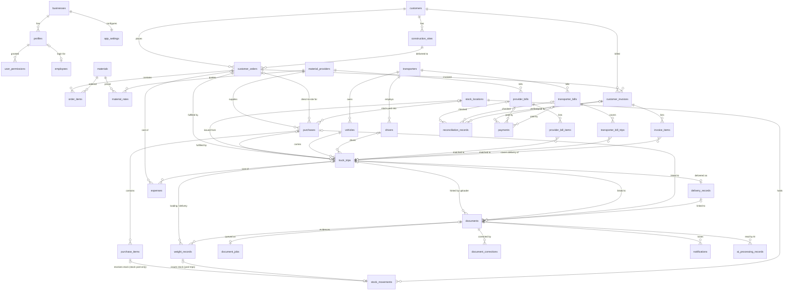

# Database schema

Postgres on Supabase. The schema is defined only by the ordered files in `supabase/migrations/`:

| Migration                     | Contents                                                                                                                                                          |
| ----------------------------- | ----------------------------------------------------------------------------------------------------------------------------------------------------------------- |
| `…120000_foundation`          | Enums, `businesses`, `profiles`, `employees`, `user_permissions`, `audit_logs`, security helpers, code generators, new-user trigger                               |
| `…120100_masters`             | Customers, sites, materials, rates, providers, transporters, drivers, vehicles, stock locations                                                                   |
| `…120200_operations`          | Orders, purchases, trips, weight & delivery records, stock movements, business-rule triggers                                                                      |
| `…120300_documents`           | Documents, AI processing records (the original WhatsApp table was removed in `…140100`)                                                                           |
| `…120400_finance`             | Bills, invoices, reconciliation, payments, expenses, app settings, numbering & totals                                                                             |
| `…120500_security`            | `updated_at` + audit triggers, RLS policies on every table, privileges                                                                                            |
| `…120600_views`               | Reporting views                                                                                                                                                   |
| `…120700_storage`             | Private `documents` bucket and its policies                                                                                                                       |
| `…120800_indexes`             | Indexes on every FK, lookups, statuses and dates                                                                                                                  |
| `…130000_enum_values`         | Units `BAG`, `NOS`; measurement method `manual_entry`                                                                                                             |
| `…130100_app_logic`           | `audit_logs.reason`, `provider_materials`, purchase cost breakdown, list views, transactional RPCs                                                                |
| `…140000_intake_enums`        | `record_source` `whatsapp` → `document`; review reasons `no_match`, `vehicle_mismatch`; status `rejected`; intake / job enums                                     |
| `…140100_document_intake`     | WhatsApp removed; upload intake, `document_jobs` queue, `document_corrections`, `ai_usage_daily`, `notifications`, worker and review functions, Realtime, pg_cron |
| `20261111100000_driver_links` | Driver upload links (`upload_tokens`, hashed), `rate_limit_hits`, grouped + financial notifications, e-mail digest switch and schedule                            |

## Conventions

- `id uuid` primary key (`gen_random_uuid()`); `business_id uuid not null` on every table
  (defaults to the signed-in user's business). One business today, multi-business ready.
- `created_at` / `updated_at` / `created_by` / `updated_by` maintained by triggers; soft delete
  with `deleted_at` on master and transactional records.
- Money is `numeric(14,2)`, quantities and weights `numeric(14,3)`. No floats.
- Statuses are Postgres enums. Units: `MT | CFT | BRASS | CUM | TRIP`. There is no conversion
  between units anywhere; order and purchase items must use the material's own unit (trigger).
- Codes: trips `TRP-2026-00123`, orders `ORD-2026-0123`, purchases `PUR-2026-0123`,
  payments `PAY-2026-0123` (sequence-backed, unique); invoices numbered from `app_settings`.

## Entity relationship diagram



`audit_logs` receives a row for every insert / update / delete on orders, items, purchases,
trips, weights, deliveries, documents, AI records (incl. corrections), bills, reconciliation,
invoices, payments, expenses, permissions, profiles, employees, settings, materials, rates and
stock movements.

## Business rules enforced in the database

| Rule                                                                                                                                                                                 | Where                                                                                            |
| ------------------------------------------------------------------------------------------------------------------------------------------------------------------------------------ | ------------------------------------------------------------------------------------------------ |
| `calculated_net = gross − tare`; mismatch with the printed net is flagged (`has_net_mismatch`), never silently fixed                                                                 | `weight_records` generated columns                                                               |
| Quantity difference = loading net − delivered net; status `normal` (≤ tolerance), `needs_verification` (≤ 2×), `confirmed_shortage` (> 2×). Operational checks, never labelled fraud | `delivery_records`, `tolerance_status_for()`, `sync_trip_measurements()`                         |
| Trip status follows the delivery check                                                                                                                                               | `sync_trip_measurements()`                                                                       |
| Stock-yard purchases create `received` stock movements; direct-to-site purchases never do (also rejected if inserted by hand); yard trips issue stock on loading                     | `sync_purchase_stock()`, `guard_stock_movement()`, `sync_trip_measurements()`                    |
| A purchase's delivery mode cannot change after items exist                                                                                                                           | `lock_purchase_delivery_mode()`                                                                  |
| Units always match the material (no MT ↔ volume conversion)                                                                                                                          | `enforce_material_unit()`                                                                        |
| Invoice totals always equal their items (+ charges + GST unless `none`)                                                                                                              | `recalculate_invoice_totals()`                                                                   |
| Payments must belong to the invoice/bill's party and cannot exceed its balance                                                                                                       | `validate_payment()`                                                                             |
| Bills, invoices and reconciliation never modify trips or purchases; a reconciliation decision only updates the bill's `recon_status`                                                 | `apply_reconciliation_status()` (only touches the bill) + RLS (bill verifiers cannot edit trips) |
| Audit log is append-only for everyone, including the owner and service role                                                                                                          | `prevent_audit_mutation()` triggers + revoked privileges                                         |

## Views (all `security_invoker`, so RLS applies)

| View                                           | Purpose                                                                                                                                            |
| ---------------------------------------------- | -------------------------------------------------------------------------------------------------------------------------------------------------- |
| `v_trip_weights`                               | Active loading / delivery weight per trip                                                                                                          |
| `v_trip_summary`                               | Trip list with names, weights, difference and tolerance status                                                                                     |
| `v_order_progress`                             | Ordered vs dispatched vs delivered per order item                                                                                                  |
| `v_customer_outstanding`                       | Invoiced, received, outstanding and overdue per customer                                                                                           |
| `v_provider_payable` / `v_transporter_payable` | Billed, paid and payable per party                                                                                                                 |
| `v_order_profit`                               | Sales − purchase − transport − loading/unloading − labour − other = estimated profit; `estimated` vs `settled`. Customer receipts are never profit |
| `v_stock_balance`                              | Received, issued, adjusted and balance per yard and material                                                                                       |
| `v_vehicle_shortage_stats`                     | Delivery differences per vehicle, recurring flag (3+ in 90 days)                                                                                   |

## Document intake and review

See `docs/intake.md` and `docs/ai-pipeline.md`. Clients never write `documents`,
`document_corrections`, `document_jobs` or `notifications` directly: uploads go through
`register_uploaded_document`, review decisions through `review_attach_document`,
`review_create_trip_from_document`, `correct_document_field`, `mark_document_duplicate`,
`reject_document`, `reprocess_document` (all permission-checked, audited); the worker uses
service-role-only functions (`claim_document_jobs`, `finish_document_job`, `defer_document_job`,
`ai_reserve_call`, `record_document_extraction`, `apply_document_decision`).

## App functions (RPCs, `SECURITY INVOKER` — RLS still applies)

| Function                                                                | Does, in one transaction                                                                                                                                 |
| ----------------------------------------------------------------------- | -------------------------------------------------------------------------------------------------------------------------------------------------------- |
| `create_customer(customer, site)`                                       | Customer + first site                                                                                                                                    |
| `create_provider(provider, material_ids)`                               | Provider + supplied materials                                                                                                                            |
| `create_vehicle(vehicle, driver)`                                       | Driver + vehicle linked to them                                                                                                                          |
| `create_material(material)`                                             | Material + opening purchase / selling rates (tolerance defaults from settings)                                                                           |
| `create_order(order, items)` / `update_order(id, order, items, reason)` | Order + items. Changing or removing an existing quantity / rate needs a reason; items with trips cannot be removed                                       |
| `create_purchase(purchase, items)`                                      | Purchase + items with labelled costs (`cost_breakdown`); stock follows from the triggers                                                                 |
| `create_trip(trip, loading, delivery)`                                  | Trip + loading weight (+ delivery weight); links the order item and direct purchase; delivery check, trip status and yard stock follow from the triggers |
| `save_weight_record(trip, type, values, reason)`                        | Adds a missing weight, or corrects one (reason required)                                                                                                 |
| `record_trip_investigation(trip, outcome, notes, status)`               | Shortage-check outcome on the delivery record                                                                                                            |
| `set_material_tolerances(values)`                                       | Owner only: tolerance per material                                                                                                                       |

Corrections set `app.change_reason` for the transaction; `audit_row_change()` stores it in
`audit_logs.reason` next to the old row, new row and user.

List views for server-side pagination / search: `v_trip_list`, `v_order_list`,
`v_purchase_list`, `v_stock_ledger` (running balance), plus `v_material_stats`,
`v_provider_stats`, `v_customer_stats`.

## Security

- RLS is enabled on every table. Helpers: `is_owner()`, `is_active_user()`,
  `has_permission(key)`, `current_business_id()` (all `SECURITY DEFINER`, fixed `search_path`).
- Owner: everything. Employees: per permission (`view_records`, `manage_orders`,
  `review_documents`, `manage_trips`, `correct_extracted`, `verify_bills`, `record_payments`,
  `view_financial_reports`). Inactive accounts see nothing.
- Financial tables (bills, invoices, payments, expenses, reconciliation) need
  `verify_bills` / `record_payments` / `view_financial_reports`; `view_records` alone is not enough.
- New auth users get an inactive `employee` profile; role, business and activation come only from
  `app_metadata` (set by the service role), never from user-editable metadata. Public sign-up is off.
- Storage bucket `documents` is private. Paths: `<business_id>/<yyyy>/<mm>/<uuid>.<ext>`. Read needs
  `view_records` or `review_documents`; upload needs `review_documents` or `manage_trips`; objects are
  never updated in place; only the owner deletes.

## Working with the schema

```sh
npx supabase migration new <name>      # new migration file
npx supabase db push                   # apply to the linked project
npm run db:types                       # regenerate src/types/database.ts
npx supabase test db --linked          # pgTAP tests in supabase/tests (rolled back)
```

If your network blocks the Postgres port, the same operations work over HTTPS:
`npx tsx scripts/supabase-api.ts status | migrate | test | seed` (records the same migration history).
